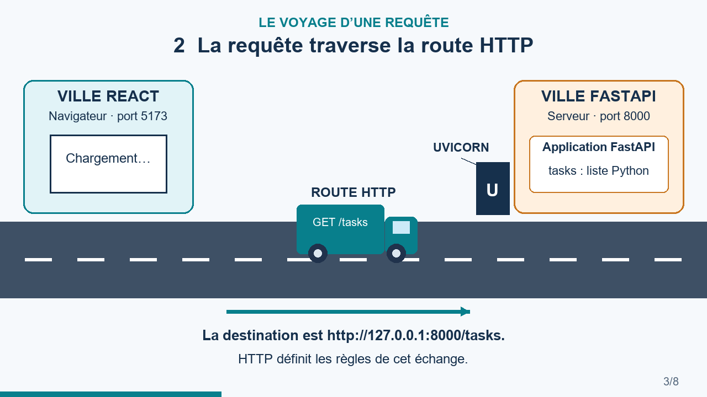
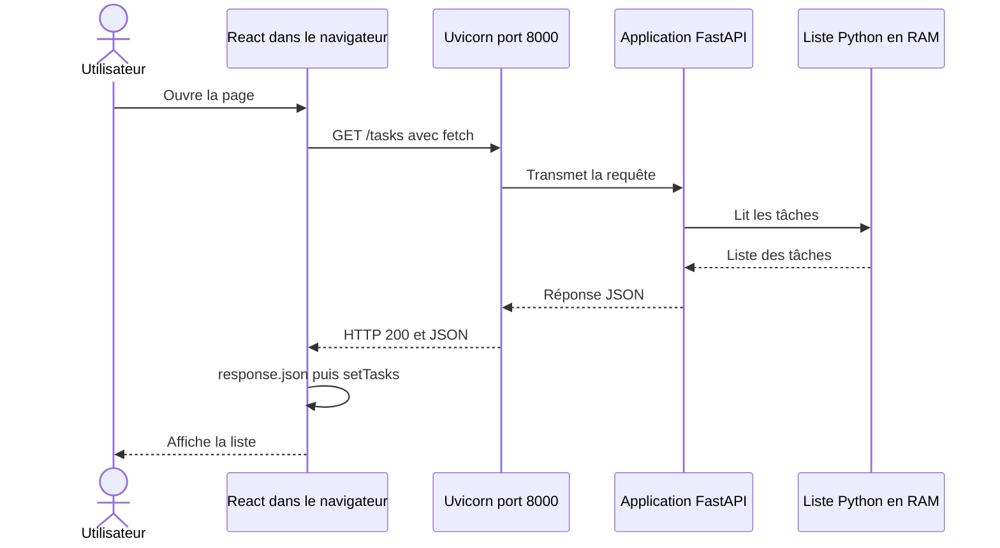
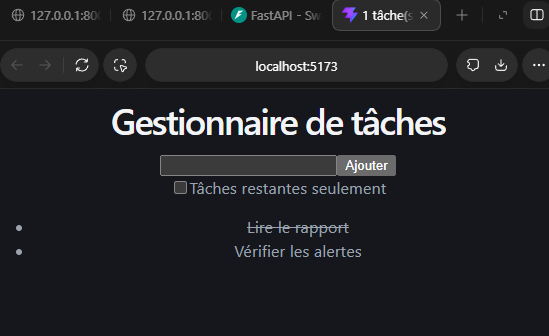
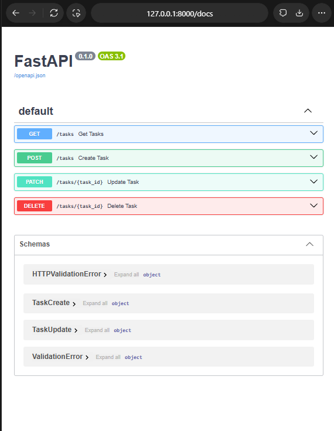

# Projet React débutant Gestionnaire de tâches

Un TP progressif pour comprendre **comment une action dans React devient une requête HTTP, un traitement FastAPI et une nouvelle liste à l’écran**.

Le projet permet de lire, créer, terminer, filtrer et supprimer des tâches. Il est écrit en **JavaScript avec JSX**, avec une API **Python / FastAPI**, servie par **Uvicorn**. Les données du serveur restent en RAM.

## Commencer selon votre besoin

| Pour apprendre | Pour le professeur |
|---|---|
| [Parcours corrigé des étapes 0 à 9](docs/PARCOURS_CORRIGE.md) | [Objectifs et preuves de réalisation](docs/POUR_LE_PROFESSEUR.md) |
| [Comprendre le trajet des données](docs/COMPRENDRE_LES_FLUX.md) | [Protocole de vérification](docs/TESTS_ET_PREUVES.md) |
| [Questions et réponses en français](docs/QUESTIONS_REPONSES.md) | [Corrigé illustré en PDF](docs/TP_React_corrige.pdf) |
| [Installer et lancer le projet](#installer-et-lancer-le-projet) | [Énoncé de référence](docs/enonce/Projet_React_debutant_Gestionnaire_de_taches.pdf) |

## Vidéo Le voyage des requêtes

Un camion transporte une requête de la ville React vers la ville FastAPI. Il revient avec la réponse JSON. **64 secondes, textes en français, sans audio et sans logo.**

<!-- VIDEO_GITHUB_ATTACHMENT -->

[](media/Le_voyage_des_requetes.mp4)

[Ouvrir ou télécharger le MP4](media/Le_voyage_des_requetes.mp4) · [Lire le script de la vidéo](media/SCENARIO.md)

## Ce qui se passe réellement



Les deux « villes » sont ici deux programmes sur le même ordinateur. La route représente les échanges HTTP. Le camion est une image pédagogique : c’est le navigateur qui échange réellement des messages réseau.

## Installer et lancer le projet

Prérequis : Git, Node.js 22.13+ ou 24+ et Python 3.12+. Node 22.13+ satisfait aussi les exigences d’ESLint 10. Les commandes ci-dessous sont prévues pour **PowerShell sous Windows**.

### Récupérer le dépôt

```powershell
git clone https://github.com/ClaFlorez/Projet_React_debutant_Gestionnaire_de_taches.git
cd .\Projet_React_debutant_Gestionnaire_de_taches
```

Le dépôt est privé : il faut un compte disposant de l’accès. Le professeur pourra le consulter une fois invité par le propriétaire.

### Terminal 1 pour FastAPI

Depuis la racine du dépôt :

```powershell
py -m venv .venv
.\.venv\Scripts\python.exe -m pip install -r requirements.txt
.\.venv\Scripts\python.exe -m uvicorn api.main:app --reload --host 127.0.0.1 --port 8000
```

Ces commandes utilisent directement Python de `.venv`. L’activation est facultative. Dans le projet de classe d’origine, `.venv` avait été créé dans le dossier parent `REACT` ; dans cette copie autonome, il est créé à la racine du dépôt.

### Terminal 2 pour React

Ouvrir un autre PowerShell **dans le même dossier du dépôt**, puis :

```powershell
npm.cmd ci
npm.cmd run dev -- --host localhost --port 5173 --strictPort
```

| Adresse | Ce qu’elle affiche |
|---|---|
| http://localhost:5173 | L’interface React |
| http://127.0.0.1:8000/docs | La documentation interactive de l’API |
| http://127.0.0.1:8000/tasks | Les tâches au format JSON |
| http://127.0.0.1:8000/ | `Not Found`, car la route `/` n’est pas définie |

Garder les deux terminaux ouverts. **Ctrl + C** arrête le programme dans le terminal concerné. Les adresses locales fonctionnent quand les serveurs sont lancés sur votre ordinateur ; elles ne déploient pas l’application sur Internet.

## Les quatre opérations CRUD

| Opération | Méthode et route | Données envoyées | Réponse attendue |
|---|---|---|---|
| Lire | `GET /tasks` | Aucune | `200` et un tableau de tâches |
| Créer | `POST /tasks` | `{"title":"Préparer le cours"}` | `201` et la tâche créée |
| Modifier | `PATCH /tasks/{task_id}` | `{"done":true}` | `200` et la tâche modifiée |
| Supprimer | `DELETE /tasks/{task_id}` | Aucune | `200` et `{"deleted": identifiant}` |

L’identifiant renvoyé par POST doit être réutilisé pour PATCH et DELETE. Il n’est pas toujours égal à 3.

## Captures commentées

### React après le chargement depuis l’API



Une tâche barrée a `done: true`. Cette capture précède l’ajout des boutons du CRUD ; le code final possède également **Changer le statut** et **Supprimer**.

### Les quatre routes dans FastAPI



Les preuves détaillées de GET, POST, PATCH et DELETE sont regroupées dans [Tests et preuves](docs/TESTS_ET_PREUVES.md).

## Organisation des fichiers

```text
api/main.py                 Application FastAPI et liste en RAM
src/App.jsx                 Composants React, états et requêtes
src/main.jsx                Montage de React dans le navigateur
src/index.css               Styles globaux
javascript-basics.js        Premier exercice sur les données
requirements.txt            Dépendances de l’API
package.json                Dépendances et commandes React
package-lock.json           Versions verrouillées côté JavaScript
docs/                       Corrigé, réponses, captures et preuves
media/                      Vidéo, aperçu et scénario
scripts/                    Vérifications et génération des supports
.github/workflows/          Vérification automatique du dépôt
```

## Vérifier le projet

```powershell
node javascript-basics.js
npm.cmd run lint
npm.cmd run build
.\.venv\Scripts\python.exe -B scripts/test_api.py
```

Le test API lance **sa propre instance temporaire** sur un port local libre. Il ne touche pas aux tâches du serveur de classe sur le port 8000. Il vérifie GET, POST, PATCH, DELETE, la tâche absente, une entrée invalide et CORS.

Les résultats exécutés pour cette archive sont consignés dans [VALIDATION.md](docs/VALIDATION.md). Les captures historiques et les tests automatisés sont distingués.

## Les notions à pouvoir expliquer

- Un **composant** décrit une partie de l’interface.
- Une **prop** est transmise du parent à l’enfant.
- Un **état** conserve une valeur entre les rendus ; son setter demande une actualisation.
- **HTTP** organise les échanges entre le navigateur et le serveur.
- **JSON** est le format textuel utilisé pour échanger les données.
- **await** attend un résultat asynchrone sans bloquer l’interface.
- **Uvicorn** reçoit les requêtes et sert l’application FastAPI.
- La **RAM** conserve temporairement la liste ; elle ne remplace pas une base de données.

Toutes les réponses détaillées sont dans [Questions et réponses](docs/QUESTIONS_REPONSES.md).

## Ce qui est conservé et ce qui se réinstalle

Le code, le verrouillage des versions JavaScript, les dépendances Python, le PDF, les captures, les schémas, le scénario et la vidéo sont archivés. Les bibliothèques `node_modules`, l’environnement `.venv`, les caches et les secrets sont exclus. Les commandes d’installation les recréent.

Le document PDF est un instantané pédagogique. Les précisions et validations plus récentes sont consignées dans les fichiers Markdown. L’origine de chaque support est décrite dans [PROVENANCE.md](docs/PROVENANCE.md).

## Limites pédagogiques

Les tâches ne sont pas sauvegardées sur disque. Redémarrer Uvicorn réinitialise la liste du serveur ; recharger le navigateur conserve les changements encore présents dans cette liste. L’API n’a pas d’authentification. La validation des titres côté serveur et les actions concurrentes peuvent être améliorées. Le formulaire vide actuellement le champ dès l’envoi, même en cas d’échec ultérieur. Voir [les limites expliquées](docs/QUESTIONS_REPONSES.md#quelles-sont-les-limites-de-cette-version).

Ce dépôt conserve le TP et ses ressources de classe. Il n’accorde pas de licence sur l’énoncé fourni par l’enseignant. Aucun logo CLAUD·IA n’est ajouté aux supports.
