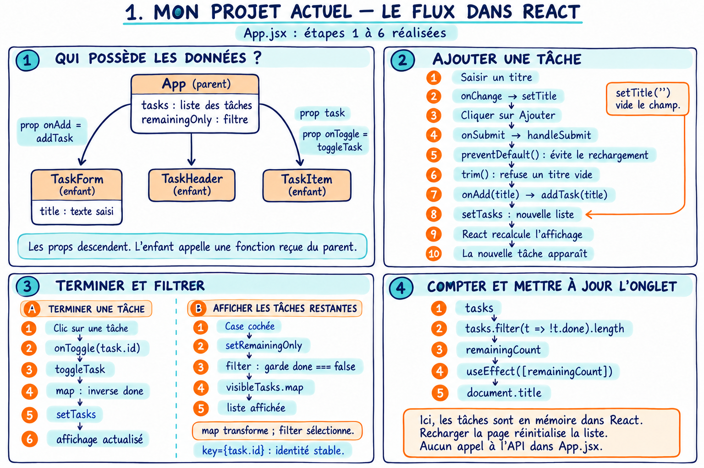
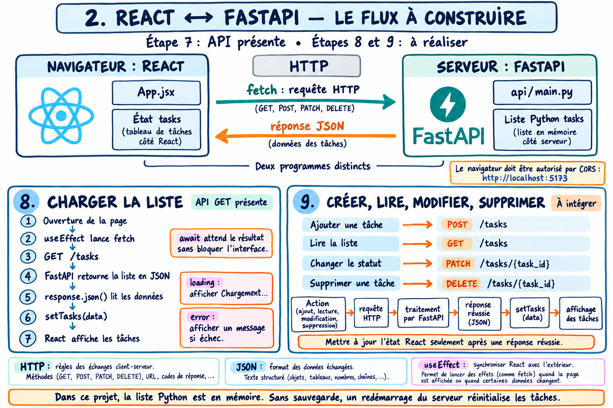

# Comprendre le trajet des données

## La route entre deux villes

La ville React représente la page dans le navigateur. La ville FastAPI représente l’application du serveur. Uvicorn est le point d’entrée du serveur. La route HTTP transporte des messages, pas une copie de l’écran.

| Dans la vidéo | Dans le programme |
|---|---|
| La ville React | Les composants affichés dans le navigateur |
| Le camion à l’aller | La requête envoyée par fetch |
| Son adresse de livraison | `http://127.0.0.1:8000/tasks` |
| La route | Le protocole HTTP |
| L’entrée Uvicorn | Le serveur qui reçoit la requête |
| Le bureau FastAPI | La fonction Python de la route |
| Le dépôt temporaire | La liste Python tasks en RAM |
| Le camion au retour | La réponse HTTP contenant du JSON |
| Le déchargement | response.json() puis setTasks |

## Lire les tâches une première fois

1. Le navigateur charge React depuis Vite, sur le port 5173.
2. App commence avec `tasks = []` et `loading = true`.
3. L’effet de chargement appelle `fetch(API_URL)` ; GET est la méthode par défaut.
4. Uvicorn reçoit la requête sur le port 8000 et la transmet à FastAPI.
5. FastAPI reconnaît `/tasks` et appelle `get_tasks()`.
6. La liste Python est sérialisée en JSON dans la réponse.
7. Le navigateur reçoit le statut HTTP ; le code vérifie `response.ok`.
8. `await response.json()` lit le corps et produit des données JavaScript.
9. `setTasks(data)` demande une mise à jour de l’état React.
10. Le rendu utilise `visibleTasks.map(...)` pour construire la liste.
11. `setLoading(false)` termine l’indication de chargement.

Le navigateur peut regrouper plusieurs mises à jour dans un même rendu. L’explication décrit le trajet logique, pas un nombre garanti de rendus.

## Ajouter une tâche

Saisie → onChange → setTitle → validation du formulaire → onAdd → addTask → JSON.stringify → POST /tasks → création Python → HTTP 201 avec la tâche → setTasks → nouvelle ligne.

`onAdd` est une fonction reçue par prop. L’enfant ne modifie pas directement la liste du parent. Le serveur attribue l’identifiant de la version finale.

## Changer le statut

Clic sur Changer le statut → onToggle(task.id) → toggleTask → recherche de la tâche → PATCH avec done inversé → modification serveur → réponse réussie → map remplace l’objet → le titre est barré ou non.

## Supprimer

Clic sur Supprimer → onDelete(task.id) → DELETE → suppression côté serveur → réponse réussie → filter retire l’identifiant de l’état React → la ligne disparaît.

## Filtrer

Case cochée → setRemainingOnly → calcul de visibleTasks → affichage des tâches dont done est faux. Aucun appel HTTP n’est nécessaire pour ce filtre. Les tâches terminées restent dans tasks et dans la liste du serveur.

## Mettre à jour le titre de l’onglet

tasks → filter des tâches non terminées → remainingCount → useEffect dépendant du nombre → document.title. Le compteur est calculé sur toutes les tâches, pas seulement sur celles visibles.

## Trois espaces à distinguer

| Espace | Contenu | Après un rechargement de la page | Après un redémarrage de l’API |
|---|---|---|---|
| État React | Copie des tâches affichées | Réinitialisé puis rechargé par GET | Ancienne copie jusqu’au prochain échange ou rechargement |
| Liste Python | Tâches en mémoire du serveur | Inchangée | Recréée à partir de main.py |
| Fichiers sur disque | Code du projet | Inchangés | Inchangés |

Une base de données ajouterait un stockage durable. Le TP n’en utilise pas.

## Les deux schémas manuscrits

Cette première fiche représente les étapes 1 à 6 : les actions étaient encore locales. Le code final remplace ces actions par des requêtes API.

Cette deuxième fiche a été créée avant la fin du TP : ses mentions « à réaliser » décrivent cette date de création. Les étapes 8 et 9 sont maintenant présentes dans le code final.
