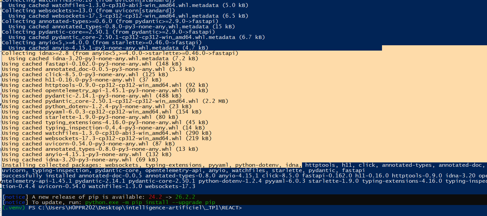

# Parcours corrigé des étapes 0 à 9

Le projet conserve le code des étapes précédentes. Le fichier réel est **src/App.jsx**. Le sujet mentionne App.tsx parce qu’il propose TypeScript ; cette réalisation utilise JavaScript avec JSDoc.

## 0 Préparer le projet

Vite prépare et sert React. Python utilise un environnement virtuel. Les [commandes du README](../README.md#installer-et-lancer-le-projet) permettent une installation autonome de cette archive.



La capture confirme une installation terminée. Elle montre le dossier parent REACT, où l’environnement de classe a été créé.

## 1 Comprendre les données JavaScript

Lire [javascript-basics.js](../javascript-basics.js).

```javascript
console.log(tasks[0].title)
const remainingTasks = tasks.filter((task) => !task.done)
console.log(remainingTasks.length)
```

Résultat calculé : `Lire le rapport`, puis `1`. Un tableau contient plusieurs valeurs ordonnées ; un objet contient des propriétés nommées. `tasks[0]` est un objet et `tasks[0].title` est une chaîne de caractères.

Aucune capture de ce premier exercice n’a été fournie. L’exécution reproductible est `node javascript-basics.js`.

## 2 Créer le premier composant

TaskHeader retourne `<h1>Gestionnaire de tâches</h1>`. App insère `<TaskHeader />` dans `<main>`. Un composant est une fonction qui décrit une partie de l’interface. Sa majuscule permet à JSX de le reconnaître comme composant.


Cette capture commune montre le titre à une étape plus avancée ; elle ne constitue pas un historique séparé de l’étape 2.

## 3 Comprendre props et état

App possède tasks. TaskItem reçoit `task` par prop. TaskForm possède title. Une prop descend du parent vers l’enfant. Un état est conservé entre les rendus et son setter demande un nouveau rendu.

```jsx
<TaskItem
  key={task.id}
  task={task}
  onToggle={toggleTask}
  onDelete={deleteTask}
/>
```

Les fonctions fournies par le parent permettent à l’enfant de lui signaler une action. L’enfant appelle une fonction ; il ne réécrit pas la prop.

## 4 Ajouter une tâche

Le formulaire contrôle son champ avec `value={title}` et `onChange`. handleSubmit empêche le rechargement, applique trim, refuse un titre vide et appelle onAdd. Dans l’étape initiale, addTask utilisait Date.now(). Dans le code final, POST renvoie l’identifiant créé côté serveur.

```javascript
event.preventDefault()
const trimmedTitle = title.trim()
if (!trimmedTitle) return
onAdd(trimmedTitle)
setTitle('')
```

onChange traite la saisie ; onSubmit traite la validation. preventDefault évite le comportement de soumission HTML qui rechargerait la page.

## 5 Terminer et filtrer

Un changement de statut inverse done. `map` sert à remplacer une tâche ou à produire un élément JSX par tâche. `filter` sélectionne une partie de la liste. La case remainingOnly sélectionne `!task.done`, sans effacer les tâches terminées.

```javascript
const visibleTasks = remainingOnly
  ? tasks.filter((task) => !task.done)
  : tasks
```

`key={task.id}` identifie chaque élément de manière stable. Si aucune tâche n’est visible, l’interface affiche « Aucune tâche ».

La [capture de l’interface](captures/05-interface-react-etape-8.png) montre une tâche barrée et une tâche restante. Elle précède les boutons de la version finale.

## 6 Utiliser useEffect

```javascript
const remainingCount = tasks.filter((task) => !task.done).length
useEffect(() => {
  document.title = `${remainingCount} tâche(s) restante(s)`
}, [remainingCount])
```

document.title est extérieur au JSX. L’effet le synchronise après le rendu, au montage et lorsque le nombre change. En développement, StrictMode peut exécuter un cycle supplémentaire de vérification.

## 7 Créer la petite API

Lire [api/main.py](../api/main.py). Uvicorn sert l’application FastAPI ; GET /tasks retourne la liste Python. CORS autorise l’origine de React, `http://localhost:5173`. React et FastAPI sont deux programmes distincts.


200 confirme la réussite de la requête. JSON est visible dans Response body. `/docs` documente l’API et `/` n’a pas de route définie.

## 8 Charger les tâches depuis l’API

tasks commence vide. loading commence à true et error est une chaîne vide. L’effet appelle une fonction asynchrone qui utilise fetch, vérifie response.ok, lit le JSON et appelle setTasks.

```javascript
const response = await fetch(API_URL)
if (!response.ok) throw new Error(`Erreur HTTP ${response.status}`)
const data = await response.json()
if (!cancelled) setTasks(data)
```

Le catch renseigne l’erreur et le finally termine loading. Le cleanup marque cancelled pour ignorer un résultat devenu inactif. Le formulaire, le filtre et la liste restent dans le JSX.

**HTTP** est le protocole des échanges. **JSON** est le format des données. **await** attend le résultat sans bloquer l’interface ; response.json est également asynchrone. fetch ne transforme pas automatiquement un statut HTTP d’erreur en exception, d’où le contrôle de response.ok.


## 9 Terminer le CRUD

L’API conserve GET et ajoute POST, PATCH et DELETE. TaskCreate décrit le corps de création ; TaskUpdate décrit les propriétés modifiables. find_task renvoie une erreur 404 si l’identifiant est absent.

Dans React, request contrôle la réponse et affiche actionError si une action échoue. addTask utilise POST et ajoute l’objet créé. toggleTask utilise PATCH et remplace l’objet retourné. deleteTask utilise DELETE et retire l’identifiant. Les setters de tasks se trouvent après la réponse réussie.

```jsx
<li>
  <span>{task.title}</span>
  <button type="button" onClick={() => onToggle(task.id)}>
    Changer le statut
  </button>
  <button type="button" onClick={() => onDelete(task.id)}>
    Supprimer
  </button>
</li>
```

Les boutons sont voisins, sans bouton imbriqué dans un autre. [Voir les trois captures CRUD et leur interprétation](TESTS_ET_PREUVES.md).

## Explication complète en une minute

« Mon application possède un client React et une API FastAPI. Uvicorn reçoit les requêtes HTTP. React charge la liste avec GET. Le formulaire crée une tâche avec POST. Un bouton change son statut avec PATCH et un autre la supprime avec DELETE. Le serveur répond avec du JSON. Après une réponse réussie, React met son état à jour, puis actualise la liste. Le filtre est un calcul local. Les tâches sont ici dans une liste Python en RAM ; il faudrait un stockage durable pour les conserver après un redémarrage. »
