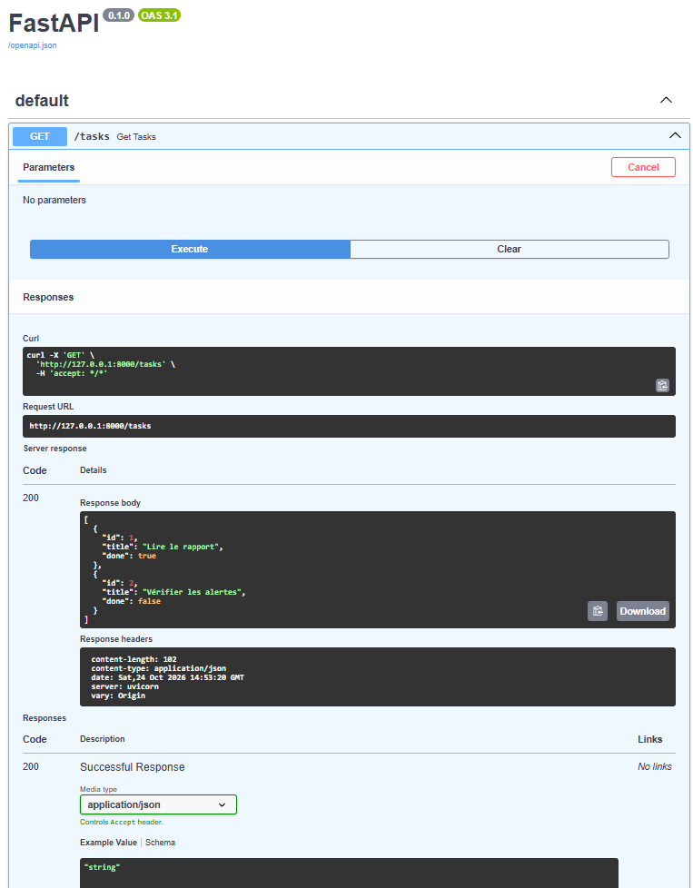
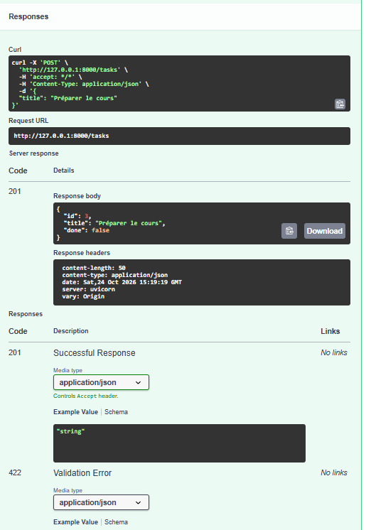
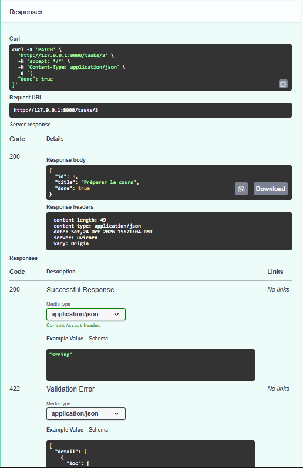
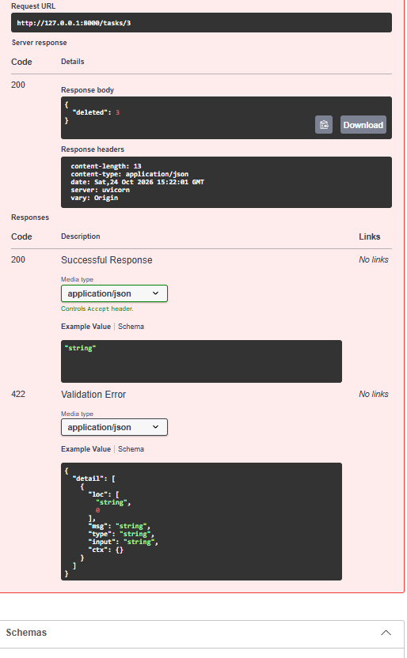
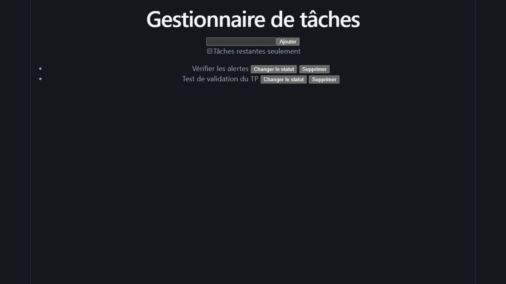
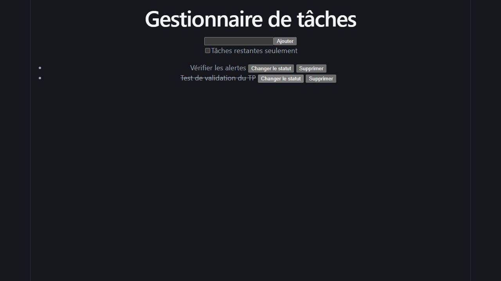
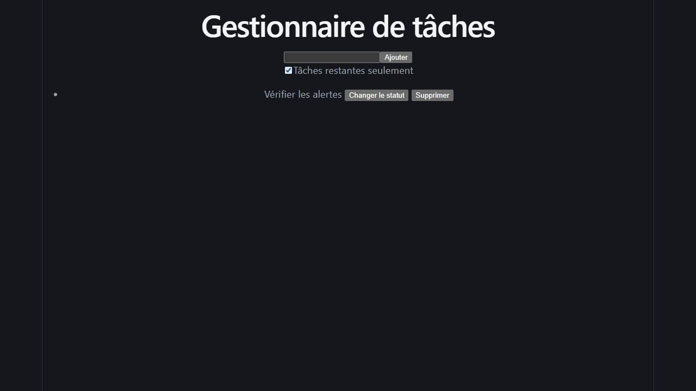

# Tests et preuves

## Captures historiques de la séance

Les captures sont conservées intégralement dans ce dépôt privé. Certaines contiennent l’interface de discussion ou des chemins locaux. Les originaux sont archivés séparément pour permettre la régénération du PDF.

### GET lire les tâches



La réponse 200 contient les deux tâches initiales. Leur ordre et leur statut sont ceux du serveur à ce moment de la séance.

### POST créer



La tâche Préparer le cours reçoit l’identifiant 3 et done false. 201 signifie Created.

### PATCH modifier



La requête cible /tasks/3 et envoie done true. Le titre est conservé et le statut change.

### DELETE supprimer



La réponse contient deleted 3. Cette tâche de test a été supprimée.

### React


Cette première image montre le chargement. Un cycle complet a ensuite été vérifié dans le navigateur et capturé ci-dessous.

### Création et rechargement depuis React



La tâche Test de validation du TP a été créée avec le formulaire. Elle revient après le rechargement de la page grâce à GET : la création est donc confirmée côté serveur.

### Changement de statut depuis React



La tâche de validation est barrée et le nombre de tâches restantes passe de 2 à 1.

### Filtre depuis React



La tâche terminée disparaît de la vue lorsque le filtre est coché. En retirant le filtre, elle revient.

### Suppression puis rechargement depuis React


La tâche de validation est supprimée et reste absente après rechargement. La tâche initiale Vérifier les alertes est conservée.

## Test automatisé isolé

```powershell
.\.venv\Scripts\python.exe -B scripts/test_api.py
```

Le script démarre sa propre instance d’Uvicorn sur une adresse locale et un port libre. Il attend son démarrage, vérifie GET, POST, PATCH, DELETE, les erreurs 404 et 422 ainsi que le précontrôle CORS. Il arrête toujours son serveur temporaire et ne modifie pas l’instance de classe.

## Vérifications manuelles dans React

- [ ] Ouvrir React et lire la liste de l’API.
- [ ] Vérifier qu’un titre vide ou constitué d’espaces n’est pas ajouté.
- [ ] Ajouter une tâche portant un titre unique.
- [ ] Recharger React et vérifier son retour par GET.
- [ ] Changer son statut et vérifier le texte barré.
- [ ] Cocher le filtre et vérifier qu’elle est masquée si elle est terminée.
- [ ] Retirer le filtre et supprimer cette tâche.
- [ ] Recharger et vérifier son absence.
- [ ] Constater le changement du titre de l’onglet.

Ces cases sont un protocole à exécuter ; elles ne constituent pas des résultats prétendument obtenus.

## Contrôles supplémentaires du dépôt

```powershell
node javascript-basics.js
npm.cmd run lint
npm.cmd run build
```

Voir [VALIDATION.md](VALIDATION.md) pour les résultats réels. Le workflow GitHub répète les contrôles de code, de compilation et d’API à chaque push.

## Dépannage

| Observation | Interprétation et action |
|---|---|
| Not Found sur / | Route absente ; ouvrir /tasks ou /docs |
| Failed to fetch | Vérifier le terminal API, l’adresse et CORS |
| Port 8000 occupé | Utiliser l’instance existante ou arrêter celle qu’on a lancée |
| React passe à 5174 | Arrêter l’autre instance ou libérer 5173 ; --strictPort évite ce changement silencieux |
| Pas de tâches après un redémarrage | La liste revient aux données initiales de main.py |
| Impression élégante | Mise en forme du JSON par le navigateur, sans impression papier |
